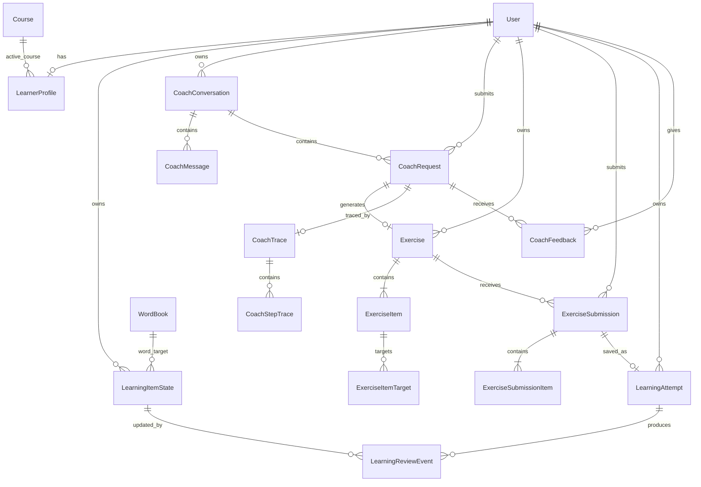

# Phase 1 Data Model: 个性化英语学习 Coach

**Feature**: `001-personalized-learning-coach`
**Date**: 2026-09-02
**Model status**: Logical design for Plan; no migration is executed in this phase.

## Design Boundaries

- The primary application PostgreSQL database is authoritative for learner-owned domain data, final Coach results, exercises, submissions, attempts, review state, Trace metadata, and feedback.
- The existing AI PostgreSQL checkpointer stores internal LangGraph checkpoints only. It is addressed by an opaque, server-generated thread ID and is never the public conversation-history source.
- Redis stores short-lived rate-limit counters, cancellation signals, BullMQ jobs, and SSE replay events. Redis is never authoritative for learning attempts or mastery updates.
- Existing `User`, `WordBook`, `WordBookRecord`, `Course`, and `CourseRecord` records remain compatible. Coach does not reinterpret payment, course ownership, legacy mastery, or word counters.

## Relationship Overview



## Existing Entity Compatibility

### `User`

No existing field changes semantics.

- `wordNumber`: remains the count maintained by the existing word-learning flow.
- `dayNumber`: unchanged.
- New relations: optional `LearnerProfile`, Coach conversations/requests, item states, submissions, attempts, feedback.

### `WordBookRecord`

- `isMaster=true` continues to mean the current course-learning flow completed that word.
- Existing unique constraint `(userId, wordId)` remains.
- The existing `saveWordMaster` business transaction will additionally initialize/update `LearningItemState`; it still owns `wordNumber`.
- Coach never clears `isMaster` and never increments `wordNumber`.

### `WordBook`, `Course`, `CourseRecord`

- `WordBook` remains the v1 word-material authority.
- `Course` remains course metadata plus a word-list tag; it is not treated as lesson or grammar content.
- `CourseRecord` remains the course access authority.

## New Persistent Entities

### 1. `LearnerProfile`

Represents user-controlled personalization facts.

| Field | Logical type | Required | Rules |
|-------|--------------|----------|-------|
| `id` | string ID | Yes | Stable internal ID. |
| `userId` | string FK → User | Yes | Unique; ownership authority. |
| `cefrLevel` | `A1|A2|B1|B2|C1|C2` | No | No default; absence means unknown. |
| `levelSource` | `USER_DECLARED` | Conditional | Required exactly when `cefrLevel` exists; v1 has no other source. |
| `goalType` | `GENERAL|EXAM|BUSINESS|TRAVEL|CUSTOM` | No | Controlled enum. |
| `goalText` | string | No | Trimmed, maximum 500 characters; never a Prompt authority. |
| `activeCourseId` | string FK → Course | No | Must have a purchased `CourseRecord` for the same user when set. |
| `timezone` | IANA timezone | Yes | Initial application default `Asia/Shanghai`; user-editable. |
| `createdAt` / `updatedAt` | timestamp | Yes | UTC storage. |

Indexes/constraints:

- Unique `userId`.
- Index `activeCourseId`.
- A service-level ownership check is required when `activeCourseId` changes; a foreign key alone is insufficient.

### 2. `LearningItemState`

Current review/mastery aggregate for one learner and one atomic learning target.

| Field | Logical type | Required | Rules |
|-------|--------------|----------|-------|
| `id` | string ID | Yes | Stable internal ID. |
| `userId` | string FK → User | Yes | Owner. |
| `targetType` | `WORD|ERROR_TYPE` | Yes | V1 target types only. |
| `targetKey` | string | Yes | `WordBook.id` for `WORD`; controlled error taxonomy value for `ERROR_TYPE`. |
| `wordId` | string FK → WordBook | Conditional | Required for `WORD`, null for `ERROR_TYPE`. |
| `reviewState` | `NEW|LEARNING|REVIEW|MASTERED` | Yes | Derived using transition rules below. |
| `repetitionCount` | non-negative integer | Yes | Successful SM-2 sequence count. |
| `easeFactor` | decimal | Yes | Starts 2.5; minimum 1.3. |
| `intervalDays` | non-negative integer | Yes | Current scheduled interval. |
| `dueAt` | timestamp | No | Null only for untouched `NEW`; stored UTC. |
| `lastReviewedAt` | timestamp | No | Set only by an effective saved attempt or legacy initialization. |
| `lastQuality` | integer 0–5 | No | Last effective quality grade. |
| `lastAttemptId` | string FK → LearningAttempt | No | Provenance for latest Coach update. |
| `createdAt` / `updatedAt` | timestamp | Yes | Audit timestamps. |

Indexes/constraints:

- Unique `(userId, targetType, targetKey)`.
- Index `(userId, targetType, dueAt)` for `get_due_words`.
- Check `easeFactor >= 1.3`, `repetitionCount >= 0`, `intervalDays >= 0`, and `lastQuality` between 0 and 5.
- Cross-field validation ensures `wordId` matches `targetKey` for `WORD`.

### 3. `LearningReviewEvent`

Immutable audit event produced when a saved attempt changes a learning item.

| Field | Logical type | Required | Rules |
|-------|--------------|----------|-------|
| `id` | string ID | Yes | Immutable. |
| `userId` | string FK → User | Yes | Must match state and attempt owner. |
| `itemStateId` | string FK → LearningItemState | Yes | Updated aggregate. |
| `attemptId` | string FK → LearningAttempt | Yes | Source attempt. |
| `targetType` / `targetKey` | enum/string snapshot | Yes | Immutable provenance. |
| `itemScore` | integer 0–100 | Yes | Validated target score. |
| `quality` | integer 0–5 | Yes | Deterministic mapping. |
| `previousState` | structured snapshot | Yes | Review state, repetitions, factor, interval, due date. |
| `nextState` | structured snapshot | Yes | Same fields after scheduling. |
| `createdAt` | timestamp | Yes | Save transaction time. |

Constraints:

- Unique `(attemptId, targetType, targetKey)` so one attempt updates one target once.
- Events are append-only; corrections create a new explicit event, never mutate history.

### 4. `CoachConversation`

Authorized, user-visible Coach conversation and checkpoint mapping.

| Field | Logical type | Required | Rules |
|-------|--------------|----------|-------|
| `id` | string ID | Yes | Public opaque conversation ID. |
| `userId` | string FK → User | Yes | Owner. |
| `title` | string | No | User-safe generated or first-message summary; max 120 characters. |
| `status` | `ACTIVE|DELETING|DELETED|EXPIRED` | Yes | `DELETED/EXPIRED` cannot accept new requests. |
| `checkpointThreadId` | random string | Yes | Unique, server generated, contains no user ID. |
| `lastActivityAt` | timestamp | Yes | Drives 90-day expiry. |
| `expiresAt` | timestamp | Yes | `lastActivityAt + 90 days`. |
| `deletedAt` | timestamp | No | Set on delete/expiry. |
| `createdAt` / `updatedAt` | timestamp | Yes | Audit timestamps. |

Indexes/constraints:

- Index `(userId, status, lastActivityAt)`.
- Unique `checkpointThreadId`.
- At most one active request per conversation; separate conversations support parallel work.

### 5. `CoachMessage`

Domain history shown to the user; checkpoint messages are not queried for UI history.

| Field | Logical type | Required | Rules |
|-------|--------------|----------|-------|
| `id` | string ID | Yes | Stable message ID. |
| `conversationId` | string FK → CoachConversation | Yes | Ownership inherited and rechecked. |
| `requestId` | string FK → CoachRequest | No | Present for request/result messages. |
| `role` | `USER|COACH` | Yes | No internal/system role exposed. |
| `content` | string | No | User-visible text only, length bounded. |
| `resultSchemaVersion` | string | No | Required when `structuredResult` exists. |
| `structuredResult` | validated JSON | No | Final Coach result only; no raw invalid model output. |
| `createdAt` | timestamp | Yes | Ordered within conversation. |

Indexes:

- `(conversationId, createdAt, id)`.

### 6. `CoachRequest`

One logical Coach operation and its durable status/idempotency authority.

| Field | Logical type | Required | Rules |
|-------|--------------|----------|-------|
| `id` | string ID | Yes | Request/queue/event correlation ID. |
| `userId` | string FK → User | Yes | Owner. |
| `conversationId` | string FK → CoachConversation | Yes | Must belong to user. |
| `clientRequestKey` | string | Yes | Client-provided opaque idempotency key, bound to owner/body hash. |
| `requestBodyHash` | hash | Yes | Same key with different body is conflict. |
| `retryOfRequestId` | string FK → CoachRequest | No | Retry lineage. |
| `inputType` | `MESSAGE|EXERCISE_SUBMISSION|RECOMMENDATION` | Yes | Drives graph entry. |
| `intent` | `ANSWER|CORRECTION|CREATE_EXERCISE|GRADE_ANSWER|REVIEW_RECOMMENDATION|UNKNOWN` | No | Set after validated classification. |
| `status` | request status enum | Yes | State machine below. |
| `exerciseId` | string FK → Exercise | No | For generation/submission path. |
| `answerVersion` | string | No | Required for submission path. |
| `promptVersion` / `modelVersion` / `budgetVersion` | string | Yes before model call | Traceable runtime configuration. |
| `deadlineAt` | timestamp | Yes | Hard total deadline. |
| `finalResultSchemaVersion` | string | No | Required on completion. |
| `finalResult` | validated JSON | No | Only post-validation result or business fallback. |
| `errorCode` | safe enum | No | No raw stack. |
| `cancelRequestedAt` | timestamp | No | Distributed cancellation state. |
| `queuedAt` / `startedAt` / `firstTokenAt` / `finishedAt` | timestamp | No | Metrics. |
| `createdAt` / `updatedAt` | timestamp | Yes | Audit timestamps. |

Constraints/indexes:

- Unique `(userId, clientRequestKey)`.
- Index `(conversationId, status, createdAt)`.
- Reusing a key with a different `requestBodyHash` returns an idempotency conflict.
- Final result is immutable after terminal state except a separate reconciliation annotation.

Request state machine:

```text
CREATED → QUEUED → RUNNING → COMPLETED
                    ├──────→ CANCELLED
                    ├──────→ TIMED_OUT
                    ├──────→ BUDGET_EXCEEDED
                    └──────→ FAILED

CREATED/QUEUED → CANCELLED
terminal state → no transition
```

### 7. `Exercise`

Server-owned exercise instance. Generating an exercise does not update learner progress.

| Field | Logical type | Required | Rules |
|-------|--------------|----------|-------|
| `id` | string ID | Yes | Opaque exercise ID. |
| `userId` | string FK → User | Yes | Owner. |
| `conversationId` | string FK → CoachConversation | Yes | Scope. |
| `requestId` | string FK → CoachRequest | Yes | Generation request; unique. |
| `type` | `MULTIPLE_CHOICE|FILL_BLANK|TRANSLATION|SITUATIONAL_DIALOGUE` | Yes | Allowed v1 types. |
| `status` | exercise status enum | Yes | State machine below. |
| `cefrDifficulty` | `A1`–`C2` or `UNKNOWN` | Yes | Effective exercise difficulty. |
| `instructions` | string | Yes | Learner-visible, bounded. |
| `personalizationReason` | string | Yes | Safe explanation. |
| `schemaVersion` | string | Yes | Exercise contract version. |
| `citations` | validated JSON array | Yes | Authorized material citations. |
| `expiresAt` | timestamp | Yes | Submission expiry. |
| `createdAt` / `updatedAt` | timestamp | Yes | Audit timestamps. |

State machine:

```text
DRAFT → READY → SUBMITTED → GRADED → SAVED
           ├──────────────→ EXPIRED
           └──────────────→ CANCELLED
SUBMITTED/GRADED ─────────→ CANCELLED (only if no save committed)
```

### 8. `ExerciseItem`

One ordered question.

| Field | Logical type | Required | Rules |
|-------|--------------|----------|-------|
| `id` | string ID | Yes | Opaque item ID. |
| `exerciseId` | string FK → Exercise | Yes | Parent. |
| `position` | positive integer | Yes | Unique within exercise. |
| `prompt` | string | Yes | Learner-visible. |
| `choices` | validated JSON array | Conditional | Required for multiple choice; forbidden otherwise unless dialogue options are explicitly modeled. |
| `answerKey` | validated JSON | Yes | Server-only; never in public schemas/events. |
| `gradingRubric` | validated JSON | Yes | Bounded deterministic/model grading instruction. |
| `maxScore` | positive integer | Yes | Exercise item totals must sum to 100. |
| `citations` | validated JSON array | Yes | Must be subset of authorized materials. |

Constraints:

- Unique `(exerciseId, position)`.
- The user-facing query selection explicitly excludes `answerKey` and `gradingRubric`.

### 9. `ExerciseItemTarget`

Normalized mapping from a question to the learning items it evaluates.

| Field | Logical type | Required | Rules |
|-------|--------------|----------|-------|
| `exerciseItemId` | FK → ExerciseItem | Yes | Parent. |
| `targetType` | `WORD|ERROR_TYPE` | Yes | Controlled. |
| `targetKey` | string | Yes | Valid word ID or error taxonomy key. |
| `wordId` | FK → WordBook | Conditional | Required for word target. |
| `weight` | decimal 0–1 | Yes | Target weights per item sum to 1. |

Constraint:

- Unique `(exerciseItemId, targetType, targetKey)`.

### 10. `ExerciseSubmission`

Workflow state for one answer version. It may hold a valid grading result before learning progress is saved; it is not itself a completed learning attempt.

| Field | Logical type | Required | Rules |
|-------|--------------|----------|-------|
| `id` | string ID | Yes | Opaque submission ID. |
| `userId` | string FK → User | Yes | Owner. |
| `exerciseId` | string FK → Exercise | Yes | Must belong to user. |
| `gradeRequestId` | string FK → CoachRequest | Yes | Grading request. |
| `answerVersion` | string | Yes | Server-computed stable version/hash. |
| `clientIdempotencyKey` | string | Yes | Bound to owner/exercise/body. |
| `answers` | validated JSON | Yes | Bounded map by item ID. |
| `status` | `RECEIVED|GRADING|GRADED_VALID|GRADING_FAILED|SAVED` | Yes | Only `GRADED_VALID` can be saved. |
| `score` | integer 0–100 | Conditional | Required for `GRADED_VALID/SAVED`. |
| `gradingHash` | hash | Conditional | Covers exercise version, answers, and valid grading result. |
| `resultSchemaVersion` | string | Conditional | Required for valid grading. |
| `gradingResult` | validated JSON | Conditional | Structured grading output. |
| `createdAt` / `updatedAt` | timestamp | Yes | Audit timestamps. |

Constraints/indexes:

- Unique `(userId, exerciseId, answerVersion)`.
- Unique `(userId, clientIdempotencyKey)`.
- A different body under the same key is a conflict.

### 11. `ExerciseSubmissionItem`

Normalized per-question grading evidence.

| Field | Logical type | Required | Rules |
|-------|--------------|----------|-------|
| `id` | string ID | Yes | Stable. |
| `submissionId` | FK → ExerciseSubmission | Yes | Parent. |
| `exerciseItemId` | FK → ExerciseItem | Yes | Must belong to same exercise. |
| `answer` | validated JSON | Yes | User answer for this item. |
| `isCorrect` | boolean | No | Null only if ungradable. |
| `score` | integer | Yes for valid grade | `0..ExerciseItem.maxScore`. |
| `correction` | string | Yes | Empty if not applicable. |
| `explanation` | string | Yes | Learner-safe. |
| `errorTypes` | controlled enum array | Yes | Empty when no error. |
| `targetQualities` | validated JSON | Yes | Per-target 0–5 quality used by save. |

Constraint:

- Unique `(submissionId, exerciseItemId)`.

### 12. `LearningAttempt`

Immutable, successfully saved learning record.

| Field | Logical type | Required | Rules |
|-------|--------------|----------|-------|
| `id` | string ID | Yes | Attempt ID. |
| `userId` | string FK → User | Yes | Owner. |
| `exerciseId` | string FK → Exercise | Yes | Source. |
| `submissionId` | string FK → ExerciseSubmission | Yes | Unique; valid grading only. |
| `saveRequestId` | string FK → CoachRequest | Yes | Write trace. |
| `score` | integer 0–100 | Yes | Copied from validated grading. |
| `errorTypes` | controlled enum array | Yes | Aggregated. |
| `gradingHash` | hash | Yes | Must match submission. |
| `savedAt` | timestamp | Yes | Commit time. |

Constraints:

- Unique `submissionId`.
- Unique `(userId, exerciseId, submissionId)`.
- Immutable after insert.

### 13. `CoachTrace`

Content-minimized trace header.

| Field | Logical type | Required | Rules |
|-------|--------------|----------|-------|
| `id` | string ID | Yes | Same user-safe trace ID returned in result. |
| `requestId` | string FK → CoachRequest | Yes | Unique. |
| `traceSubjectId` | random pseudonymous ID | Yes | Mapping to user stored separately and deleted on user deletion. |
| `promptVersion` / `promptHash` | string | Yes | No Prompt text. |
| `modelProvider` / `modelName` / `modelVersion` | string | Yes | Exact runtime configuration. |
| `ttftMs` / `totalDurationMs` | non-negative integer | No | Required when applicable. |
| `inputTokens` / `outputTokens` | non-negative integer | Yes | Zero allowed. |
| `estimatedCost` / `currency` | decimal/string | Yes | Versioned price basis. |
| `schemaFailureCount` / `retryCount` | non-negative integer | Yes | Aggregate. |
| `terminalStatus` | safe enum | Yes | Completed/cancelled/etc. |
| `resultType` | Coach response type | No | Set on completion/degraded result. |
| `createdAt` / `expiresAt` | timestamp | Yes | 180-day metadata retention. |

No raw user message, model response, JWT, Prompt, tool arguments, stack, or secret is stored here.

### 14. `CoachStepTrace`

Ordered model/tool/workflow evidence.

| Field | Logical type | Required | Rules |
|-------|--------------|----------|-------|
| `id` | string ID | Yes | Stable. |
| `traceId` | FK → CoachTrace | Yes | Parent. |
| `sequence` | non-negative integer | Yes | Unique per Trace. |
| `stepName` | controlled enum | Yes | Graph node name. |
| `toolName` | controlled tool enum | No | Only for tool step. |
| `status` | `STARTED|SUCCEEDED|FAILED|SKIPPED|CANCELLED|TIMED_OUT` | Yes | Terminal per step. |
| `durationMs` | non-negative integer | No | Set on terminal. |
| `inputTokens` / `outputTokens` | non-negative integer | Yes | Model steps; zero otherwise. |
| `schemaFailureCount` / `retryCount` | non-negative integer | Yes | Step-local. |
| `errorCode` | safe enum | No | No stack or raw provider payload. |
| `redactedMetadata` | validated JSON | No | Allowlist only: counts, types, source IDs/hashes, never free-form payloads. |
| `createdAt` | timestamp | Yes | Audit timestamp. |

Constraint:

- Unique `(traceId, sequence)`.

### 15. `CoachFeedback`

User feedback linked to a completed/degraded request.

| Field | Logical type | Required | Rules |
|-------|--------------|----------|-------|
| `id` | string ID | Yes | Stable. |
| `userId` | string FK → User | Yes | Owner. |
| `requestId` | string FK → CoachRequest | Yes | Must belong to same user. |
| `rating` | `UP|DOWN` | Yes | V1 feedback value. |
| `category` | controlled enum | No | Incorrect, too hard, too easy, irrelevant, unsafe, other. |
| `comment` | string | No | Maximum 1,000 characters; privacy notice applies. |
| `createdAt` / `expiresAt` | timestamp | Yes | 180-day expiry. |

Constraint:

- Unique `(userId, requestId)`; update replaces the user's prior feedback rather than creating duplicates.

### 16. `TraceSubjectMapping`

Separate mapping that permits authorized support lookup without embedding a user ID in Trace.

| Field | Logical type | Required | Rules |
|-------|--------------|----------|-------|
| `traceSubjectId` | random ID | Yes | Primary key. |
| `userId` | string FK → User | Yes | Unique or rotated by policy. |
| `createdAt` | timestamp | Yes | Audit timestamp. |

Deletion behavior:

- Delete immediately on account/Coach-data deletion.
- Trace metadata may remain until its expiry but is no longer attributable to the user.

## Redis Ephemeral Data

| Key/stream | Content | TTL | Authority |
|------------|---------|-----|-----------|
| `coach:events:{requestId}` | Versioned SSE events with sequence IDs; content deltas and final event. | 1 hour after terminal event. | Replay only; final result comes from database. |
| `coach:cancel:{requestId}` | Cancellation flag and timestamp. | 24 hours maximum. | Signal; durable request status is authoritative. |
| `coach:rate:{subject}:{window}` | User/IP rate counters. | Window plus safety margin. | Rate enforcement. |
| `coach:budget:{requestId}` | Current tool/model/cost counters for fast checks. | 24 hours maximum. | Database Trace is final evidence. |
| BullMQ job | Request ID and non-sensitive routing metadata. | Queue policy. | Execution scheduling; domain row owns status. |

No JWT, API key, full profile, answer key, database credential, or system Prompt may enter Redis events/jobs.

## Error Taxonomy

V1 controlled learner error types:

```text
VOCABULARY
SPELLING
GRAMMAR
TENSE
ARTICLE
PREPOSITION
COLLOCATION
WORD_ORDER
EXPRESSION
COMPREHENSION
OTHER
```

Internal request failure codes are separate and include:

```text
AUTH_REQUIRED
TOKEN_INVALID
FORBIDDEN
RESOURCE_NOT_FOUND
VALIDATION_FAILED
SCHEMA_INVALID
MATERIAL_NOT_AVAILABLE
MODEL_UNAVAILABLE
TOOL_TIMEOUT
REQUEST_TIMEOUT
BUDGET_EXCEEDED
RATE_LIMITED
IDEMPOTENCY_CONFLICT
STATE_CONFLICT
CANCELLED
INTERNAL_ERROR
```

## Review Algorithm and State Transitions

### Quality mapping

Each learning target is updated once per saved attempt. If multiple exercise items cover the same target, use the lowest validated target quality so a weak occurrence is not hidden by an easier item.

```text
100%, no hint/correction      → q=5
80–99% or self-corrected      → q=4
60–79%                       → q=3
40–59%                       → q=2
1–39%                        → q=1
0%, blank, or ungradable      → q=0
```

### E-Factor

```text
newEF = max(
  1.3,
  oldEF + (0.1 - (5 - q) * (0.08 + (5 - q) * 0.02))
)
```

### Scheduling

For `q < 3`:

- `repetitionCount = 0`
- `intervalDays = 1`
- `reviewState = LEARNING`
- `dueAt = start of next local learning day`

For `q >= 3`:

- Increment `repetitionCount`.
- Repetition 1: 1 day.
- Repetition 2: 6 days.
- Repetition 3+: `ceil(previousIntervalDays × newEF)`.
- `MASTERED` only when repetition count is at least 3, latest `q >= 4`, and interval is at least 30 days; otherwise `REVIEW`.

For `q < 4`, final recommendation is normally `practice`; saving another review requires a new user answer.

All due calculations use the learner profile timezone and store UTC timestamps.

## Atomic `save_attempt` Transaction

The learning-domain service performs these steps in one primary database transaction:

1. Lock/read the authenticated user's `ExerciseSubmission`.
2. Verify exercise/submission ownership, `GRADED_VALID`, answer version, grading hash, and allowed exercise state.
3. Return the existing `LearningAttempt` if the submission was already saved.
4. Insert exactly one immutable `LearningAttempt`.
5. For each unique target, read/create `LearningItemState`, calculate one state transition, insert one `LearningReviewEvent`, and update the aggregate.
6. Mark submission `SAVED` and exercise `SAVED`.
7. Commit.

If any validation or update fails, the transaction rolls back. Trace completion is recorded after commit and cannot make the domain transaction partially successful.

## Legacy Backfill

For each existing `WordBookRecord` where `isMaster=true`, create the missing `(userId, WORD, wordId)` state:

```text
reviewState = REVIEW
repetitionCount = 1
easeFactor = 2.5
intervalDays = 1
lastReviewedAt = WordBookRecord.updatedAt
dueAt = max(WordBookRecord.updatedAt + 1 day, fixed rollout timestamp)
```

The operation is idempotent through the unique target constraint. It never changes `WordBookRecord` or `User.wordNumber`.

## Retention and Deletion

1. User-visible domain queries exclude `DELETING`, `DELETED`, and expired data immediately.
2. Conversation deletion enqueues a purge job that:
   - deletes messages, exercises, unsaved submissions, requests, feedback text, and Redis keys;
   - calls `PostgresSaver.deleteThread(checkpointThreadId)`;
   - preserves core saved learning attempts/review events unless the user requested learning-data/account deletion.
3. Account/learning-data deletion purges learner profile, attempts, review events, current item states, and Trace subject mapping within 24 hours.
4. Trace metadata expires at 180 days and cannot retain raw user/model content.
5. A content-free deletion tombstone prevents a backup restore from reactivating deleted Coach data; it expires only after the infrastructure backup window.

## Validation Invariants

- No public or tool input schema contains `userId`.
- Every learner-owned row is queried with the authenticated user scope even when its ID is globally unique.
- The user-facing exercise projection cannot select `answerKey` or `gradingRubric`.
- A `LearningAttempt` cannot exist without one valid submission and one save request.
- A learning target is updated at most once per attempt.
- A final Coach message contains only a validated result schema version.
- Terminal requests cannot transition or emit a second final result.
- Checkpoint thread IDs and Trace IDs contain no user identity.
- `ErrorEntry` telemetry is not related to any learner error entity or query.
