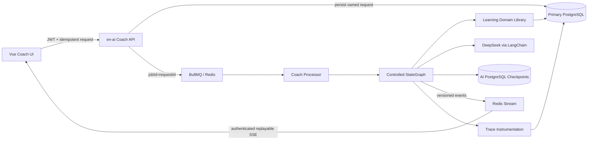

# Implementation Plan: 个性化英语学习 Coach

**Branch**: `001-personalized-learning-coach` (logical Spec Kit branch; no Git branch hook configured) | **Date**: 2026-09-02 | **Spec**: [spec.md](./spec.md)

**Input**: Feature specification from `/specs/001-personalized-learning-coach/spec.md`

**Plan boundary**: This document describes architecture and design. It does not install dependencies, execute migrations, modify business code, create implementation tasks, deploy, commit, or push.

## Summary

Add a new authenticated Coach experience beside the existing generic AI chat. The Coach runs as one controlled LangGraph workflow in `en-ai`, with deterministic routing and write gates around limited LLM nodes. It obtains learning data only through a reusable learning-domain library, uses shared Zod contracts for tools/SSE/final results, queues work with BullMQ, streams replayable events through Redis, persists learner-owned domain state in PostgreSQL, and keeps internal graph checkpoints in the existing AI PostgreSQL database.

The design closes the existing gaps without claiming missing capabilities already exist:

- Add user-declared CEFR/goal, exercises, submissions, attempts, error taxonomy, SM-2 review state, Trace, feedback, and deletion lifecycle.
- Preserve existing `WordBookRecord.isMaster`, `User.wordNumber`, current course-learning endpoints, and generic `/chat`.
- Use the existing word dictionary and course metadata for v1 material search; grammar materials return a declared unavailable result until a real source exists.
- Make learning writes atomic and database-idempotent; queue/Redis deduplication is secondary.
- Establish 50–100 synthetic/hand-authored evaluation cases and baseline-relative performance/cost gates before enabling production writes.

## Technical Context

**Language/Version**: Server TypeScript 5.7 targeting ES2023; Vue workspace TypeScript 6.0; Node.js `^20.19.0 || >=22.12.0` from the current web manifest.

**Primary Dependencies**:

- Existing: NestJS 11, Prisma 7.6 with PostgreSQL adapter, LangChain 1.3, `@langchain/core` 1.1, `@langchain/deepseek` 1.0, PostgreSQL LangGraph checkpointer 1.0, BullMQ 5.76, Vue 3.5, Pinia 3, Axios, and `@microsoft/fetch-event-source` 2.0.
- Planned explicit additions for Implement approval: `@langchain/langgraph`, `zod`, `ioredis`, `vitest`, `@vue/test-utils`, and `@playwright/test`.
- No vector, embedding, external tracing, or multi-Agent dependency.

**Storage**:

- Primary PostgreSQL (`DATABASE_URL`): learner profile, conversation history, requests, exercises, submissions, saved attempts, item state/review events, Trace metadata, feedback, deletion state.
- AI PostgreSQL (`AI_DATABASE_URL`): opaque-thread LangGraph checkpoints only.
- Redis: BullMQ, distributed rate/concurrency counters, cancellation signals, budget counters, and one-hour SSE replay streams.
- No pgvector/RAG store in v1.

**Testing**:

- Existing Jest 30 and Supertest 7 for server unit, contract, integration, fault-injection, and e2e tests.
- Planned Vitest/Vue Test Utils for UI state/schema tests and Playwright for stream/cancel/reconnect paths.
- Versioned JSONL evaluation runner using existing `tsx`, deterministic mocked runs in CI, live-model runs for release candidates.

**Target Platform**: Ubuntu 24.04 deployment, PM2 cluster mode for `en-server` and `en-ai`, PostgreSQL/Redis/MinIO infrastructure, and modern browsers supported by the current Vue/Vite application.

**Project Type**: pnpm monorepo web application with Vue frontend, two NestJS applications, shared workspace packages, and Nest libraries.

**Performance Goals**:

- Measure TTFT, total duration, input/output tokens, tool/model calls, retries, and estimated cost for every request.
- All configured budget violations stop safely before later tools/writes.
- Candidate performance and quality must remain inside a baseline-derived, explicitly approved relative regression tolerance.
- No guessed production numbers are declared in Plan; production startup/write enablement fails closed until the measured budget policy is supplied.

**Constraints**:

- Identity only from verified server JWT context; no model/public/tool `userId`.
- One controlled workflow; no free arbitrary tool loop and no multi-Agent system.
- `save_attempt` is the only Coach learning-data write tool.
- No partial or duplicate attempt/mastery writes.
- No raw reasoning, system Prompt, secrets, stack, answer key, or other-user data in API/SSE/logs/Trace.
- First-version retrieval uses existing dictionary/course sources; grammar-source absence is explicit.
- Existing non-Coach routes and legacy learning semantics remain compatible.

**Scale/Scope**:

- Current two-backend PM2 cluster architecture; all request coordination must work across instances.
- One active request per conversation, with separate conversations providing user-level parallelism.
- Four exercise types, six internal tools, one result schema version, one SSE version, and 50–100 initial evaluation cases.
- User/request volume is not documented; rate and concurrency values are therefore mandatory deployment configuration derived from baseline/load evidence.

## Constitution Check

*GATE: evaluated before Phase 0 and re-evaluated after Phase 1.*

The repository constitution is still an unratified placeholder template, so it defines no enforceable project-specific principles. The repository AI skill and specification provide the active gates:

| Gate | Pre-design result | Evidence |
|------|-------------------|----------|
| Correct repository boundary | PASS | Remote is `https://github.com/cjw32/en-learning-plus.git`; original `/en-learning` remains read-only reference. |
| Specify precedes Plan | PASS | `spec.md` exists with FR-001–FR-074 and SC-001–SC-012; three clarifications were resolved in Phase 0 and reflected back to the spec. |
| Least-privilege tools and user isolation | PASS | Immutable auth context, no tool identity field, owned-resource rechecks, only one write tool. |
| Structured output and failure path | PASS | Shared Zod/JSON Schema, one retry, deterministic safe repair, validated fallback, no invalid write. |
| Cost/latency policy | PASS WITH PRE-RELEASE GATE | Policy shape is complete; evidence-derived production values are required before write enablement. |
| Privacy and retention | PASS | Explicit lifecycles, no raw Trace by default, production conversations excluded from v1 evaluation. |
| Scope control | PASS | No pgvector, full RAG, MCP Server, multi-Agent, pronunciation, payment, or broad unrelated refactor. |
| Test/evaluation traceability | PASS | Quickstart and requirement coverage define deterministic, AI-quality, browser, failure, migration, and regression evidence. |

No constitution violation requires a complexity exception. The empty constitution should be ratified separately, but that is outside this feature and does not change the feature gates above.

## Architecture

### Runtime Flow



### Request Lifecycle

1. Vue sends an authenticated, schema-valid request with `Idempotency-Key`; it never sends a user ID.
2. The AI controller verifies access JWT, request ownership, rate/concurrency policy, idempotency body hash, and token expiry. It persists a `CoachRequest` and enqueues only the request ID.
3. Vue opens the authenticated SSE URL returned by the 202 response.
4. A BullMQ processor loads the durable request and builds `CoachExecutionContext` from the authenticated subject recorded by server code. No token or learner payload is placed in the job.
5. The graph executes only allowed nodes and publishes safe events to a Redis Stream.
6. Learning queries/writes pass through `@libs/learning` services. The graph/tool adapters never use Prisma directly.
7. Model calls receive only task-specific Prompt, recent bounded conversation context, minimum learner snapshot, and authorized materials.
8. The server validates structured output, citations, scenario consistency, and budgets.
9. For a valid answer grade, `save_attempt` executes one primary-database transaction. The final result reports saved/replayed/not-saved accurately.
10. The validated final result and user-visible Coach message are persisted before `result`/`completed` events.

## Controlled Workflow Design

### Graph State

The internal Zod-validated graph state contains:

```text
requestId, conversationId, traceId
authenticatedSubject (private runtime context)
deadline, cancellationState, budgetState
inputType, userMessage or owned submission reference
intent, requestedExercisePreferences
learnerProfileSnapshot, dueWords
materialResults, citations
exercise, gradingResult, saveResult
nextAction, finalResult
stepErrors, schemaRetryCount
```

Private runtime identity and budget context are not graph input/output fields visible to the model.

### Nodes and Authority

| Node | Type | Authority and output |
|------|------|----------------------|
| `validate_request` | Deterministic | Revalidates durable request state, auth expiry/deadline, cancellation, input Schema, ownership, and budget. |
| `classify_intent` | Structured model + deterministic validation | Returns one allowed intent; user hint is non-authoritative. |
| `load_profile` | Tool node | Calls `get_learner_profile` with immutable auth context. |
| `load_due_words` | Guarded tool node | Runs only for exercise/review paths that need due vocabulary. |
| `load_materials` | Guarded tool node | Uses provider-neutral material service; grammar may return unavailable. |
| `generate_answer` | Structured model | Produces answer/correction content and citation references from allowed source IDs. |
| `create_exercise` | Guarded tool node | Generates/persists an owned exercise; no learner progress write. |
| `grade_answer` | Guarded tool node | Loads owned exercise/answer key and creates a valid submission grade; no mastery write. |
| `validate_grade` | Deterministic | Recomputes objective totals, validates subjective structured output, answer version, citation set, and grading hash. |
| `save_attempt` | Deterministic write tool node | Runs only after valid grade; transactionally writes one attempt and item-state changes. |
| `select_next_action` | Deterministic policy | `practice` for current low-quality targets, otherwise `review` when due items exist, otherwise `continue`. |
| `explain_next_action` | Structured model | Explains the fixed action using only validated state; cannot change the enum. |
| `validate_final_result` | Deterministic | Enforces `coach.result.v1`, citation/source subset, scenario invariants, redaction, and saved-state truth. |
| `build_fallback` | Deterministic business code | Produces a valid degraded result; never fabricates score, citation, exercise, or learning update. |
| `terminal` | Deterministic | Persists final status/result and emits exactly one terminal sequence. |

### Routing

| Intent | Required path | Optional path | Prohibited path |
|--------|---------------|---------------|-----------------|
| Answer/learning method | profile → answer → recommend → final | materials | grade/save |
| Sentence correction | profile → correction → recommend → final | materials | save |
| Exercise generation | profile → materials → create exercise → recommend → final | due words | grade/save |
| Answer submission | owned exercise → grade → validate grade → save → recommend → final | profile/due words for recommendation | save before valid grade |
| Review recommendation | profile → due words → recommend → final | materials for examples | grade/save |

Looping is limited to one structured-output retry and one deterministic non-semantic envelope repair. Tool/model call counters and deadline are checked before every node.

## Model and Prompt Strategy

- Keep the existing DeepSeek integration and make model name/version explicit in `ModelPolicy`.
- Use the chat model by default. Reasoner use requires a distinct evaluated/budgeted policy and is disabled for v1 launch.
- Do not use the current generic persona prompts for Coach.
- Store Coach prompts as code-owned templates with semantic version, content hash, purpose, input schema version, and output schema version.
- Use one small Prompt per model node. Delimit user input and material excerpts as untrusted data.
- Use `withStructuredOutput`/LangChain structured strategy backed by Zod. Local validation remains authoritative even if the provider supports native structure.
- Objective multiple-choice and exact-fill scoring is deterministic. Translation/dialogue grading uses structured model scoring against the stored rubric; business code calculates the total.
- Stream only recognized learner-visible field deltas when the model/runtime provides a safe structured stream. Otherwise stream statuses and emit content in the final result; never parse arbitrary partial JSON into a persisted result.
- On first Schema failure, retry once with a safe validation summary. A deterministic repair may remove unknown fields or fill business-owned envelope fields only; it cannot invent correction, score, citation, or answer. Remaining failure uses a business fallback.

## Identity and Authorization

### HTTP/SSE

- Apply the existing access-token verification semantics to every `/coach` route.
- Add matching authorization/refresh handling to `aiApi`.
- The SSE helper receives the access token and `AbortSignal`; it does not put auth in query parameters.
- Request deadline is capped by access-token expiry. When the expiry boundary is reached, the worker aborts and the client reauthenticates before retry.
- Stream/retry/cancel/history/delete/feedback reauthenticate and recheck owner from the database.

### Worker Context

- Queue payload is `{requestId}` only.
- The worker loads the server-recorded subject, auth expiry, conversation, and request. It does not reconstruct identity from Prompt or model output.
- `CoachExecutionContext` is injected out of band into tool adapters.
- Every domain service accepts authenticated subject separately from resource IDs and applies owner scoping.

### Prompt Injection

- Model output cannot select identity, graph node, save eligibility, direct query, or arbitrary tool.
- Retrieved/user text is data, not instruction; no system Prompt/tool description is included in citations.
- Unknown/other-user IDs are not resolved for the model and yield the same safe public result as nonexistent IDs.

## Learning Domain and Tool Mapping

| Tool | Adapter | Business service | Direct DB in adapter |
|------|---------|------------------|----------------------|
| `get_learner_profile` | Coach read tool | `LearnerProfileService` | No |
| `get_due_words` | Coach read tool | `ReviewScheduleService` | No |
| `search_learning_materials` | Coach read tool | `LearningMaterialService` with v1 providers | No |
| `create_exercise` | Coach compute tool | `ExerciseService` + structured model gateway | No |
| `grade_answer` | Coach compute tool | `GradingService` + deterministic scorers/model gateway | No |
| `save_attempt` | Coach write tool | `AttemptService` + `ReviewScheduleService` in one transaction | No |

Existing services delegate as follows:

- `LearnService.getWordList` keeps its public contract and uses existing access rules.
- `LearnService.saveWordMaster` keeps legacy output but calls the shared review initializer in the same transaction.
- `WordBookService`/`CourseService` retain current endpoints; material-provider queries reuse their domain logic in `@libs/learning`.
- The existing digest `queryTool` is not reused; any later refactor is separate from Coach.

## Personalization Policy

- Declared CEFR and active purchased course are explicit profile facts.
- No default CEFR is assigned when missing.
- Recent attempts affect weak-target selection, hint density, example familiarity, and recommendation, but never silently overwrite CEFR.
- Known vocabulary combines:
  - legacy completed words (`WordBookRecord.isMaster`);
  - Coach item states and recent attempts, labeled separately.
- Weak items prioritize latest quality below 3, repeated error types, overdue items, and low recent target performance.
- `get_due_words` only returns `WORD` targets with `dueAt` within the learner's local learning day and applies a stable cap/order.
- Generated content may use one bounded challenge step above declared CEFR only when labeled as a challenge; it cannot be treated as already learned.
- Profile output explicitly marks each signal available/missing/stale/not-applicable.

## Mastery and Review

- Implement the exact SM-2-based transitions in [data-model.md](./data-model.md).
- Save updates each unique target once, using the lowest validated target quality when multiple items cover it.
- `MASTERED` is a Coach display/review state, not the legacy `isMaster` flag.
- `q < 4` normally yields `nextAction=practice`; overdue items without current low-quality results yield `review`; otherwise `continue`.
- Existing mastered words are backfilled deterministically before Coach write enablement.
- Future scheduling algorithms can be versioned per `LearningReviewEvent`; v1 records `SM2_V1`.

## Material Search and Citation Boundary

Define `LearningMaterialProvider.search(query, context)`:

```text
WordBookMaterialProvider → existing dictionary and exam tags
CourseMaterialProvider   → existing course metadata + current-user ownership
GrammarMaterialProvider  → DATA_NOT_AVAILABLE until a real approved source exists
FutureVectorProvider     → same result/citation interface; not implemented in v1
```

Rules:

- Source IDs are stable and checked again before final output.
- Course references expose only content the current user can access.
- Generated examples are not citations.
- Existing Bocha web search is not part of Coach v1 materials and is never labeled RAG.
- Citation validation ensures every cited ID was returned by this request and supports the associated claim/question.

## API and Streaming

- HTTP lifecycle: [coach-api.openapi.yaml](./contracts/coach-api.openapi.yaml).
- SSE event, replay, cancel, and UI-state behavior: [coach-sse.md](./contracts/coach-sse.md).
- Final result: [coach-result.schema.json](./contracts/coach-result.schema.json).
- Internal tools: [coach-tools.schema.json](./contracts/coach-tools.schema.json).

Creation and streaming are separated:

1. `POST .../requests` returns 202 with request/Trace IDs and a stream URL.
2. `GET .../events` reauthenticates and reads the Redis Stream.
3. `Last-Event-ID` replays without re-running the request.
4. Explicit retry creates lineage; it is not triggered merely by SSE disconnect.
5. Durable `GET /requests/{id}` is the fallback after the event buffer expires.

The current generic `/ai/v1/chat` contract remains unchanged. Coach uses new `/ai/v1/coach/*` routes.

## Cancellation, Retry, and Idempotency

- API creation, profile changes, retry, cancellation, feedback, answer submission, and deletion require `Idempotency-Key`.
- Database unique constraints and body hashes are authoritative.
- BullMQ `jobId=requestId` prevents duplicate job creation.
- Redis pub/sub/key plus durable request status allows cancellation across PM2 workers.
- Originating worker passes `AbortSignal` to LangChain/model calls and checks cancellation before each graph node.
- A disconnected SSE client does not imply cancellation.
- A save transaction returns existing attempt on replay; it cannot apply SM-2 twice.
- Unknown post-commit client state is resolved by request/submission ID, never by re-running a blind write.

## Request Governance

### Policy fields

`CoachBudgetPolicy` is versioned and requires:

```text
rateWindowSeconds
maxRequestsPerWindow
maxConcurrentRequests
maxInputTokens
maxOutputTokens
maxEstimatedCost + currency
maxModelCalls
maxToolCalls
maxPerToolDurationMs
maxTotalDurationMs
maxSchemaRetries
modelPriceVersion
```

Enforcement:

- Rate/concurrency keys are authenticated-subject scoped; unauthenticated abuse has a separate IP/device gate.
- Estimate before model/tool start, charge measured usage after each call, and refuse the next node if remaining budget is insufficient.
- Per-tool and total deadlines use abort signals.
- A model/version with no price basis cannot run in production Coach.
- No production write feature starts with missing/placeholder budget values.
- The first approved values come from the evaluation baseline; Plan does not invent them.

## Observability and Privacy

### Trace

Persist Trace header and ordered step records from [data-model.md](./data-model.md):

- Prompt/model/schema/budget versions.
- TTFT measured at first learner-visible content delta, or final result if no delta is emitted.
- Total duration, token counts, model/tool calls, retries, estimated cost.
- Tool order/duration/status and safe failure code.
- Schema failures, cancellation, timeout, budget stop, degradation, save/replay/not-saved status.
- Feedback association.

Trace metadata uses a random subject mapping. Logs carry Trace/request IDs but not raw learner content. Allowlisted redacted metadata contains counts, enums, source IDs/hashes, and result types only.

### Retention

- Core learning data: account lifetime, purge within 24 hours of relevant deletion.
- Conversation/checkpoint: 90 days inactivity or earlier user deletion.
- Redis replay: one hour; non-content reconciliation state: 24 hours.
- Content-free Trace metadata: 180 days.
- Diagnostic content: disabled by default, explicit/redacted, seven days maximum.
- Feedback: 180 days or user deletion.
- V1 evaluation: synthetic/hand-authored only, no direct production conversation.

Conversation purge calls `PostgresSaver.deleteThread`. Account deletion removes Trace subject mapping so retained aggregate metadata cannot be attributed.

## Data Migration and Backfill Design

The Implement phase will create one reviewed Prisma migration for the entities and constraints in [data-model.md](./data-model.md), followed by an idempotent backfill:

- Create new tables/enums/indexes without changing existing field meaning.
- Backfill one word item state for each existing mastered word using a fixed rollout timestamp.
- Validate counts and uniqueness before enabling Coach writes.
- Update legacy `saveWordMaster` to initialize review state transactionally for new completions.
- Do not delete old columns or require a destructive rollback.

Rollback strategy:

- Disable Coach UI/request/write feature flags.
- Keep additive tables and legacy delegation compatible.
- Existing word/course/chat paths continue using their original public contracts.
- Do not reverse a migration by deleting captured learning attempts; corrective migrations are required.

## Evaluation and Test Design

### Dataset

Store versioned assets under `server/apps/ai/test/evals/`:

```text
fixtures/cases.jsonl
rubrics/*.json
expected/tool-paths.json
baselines/<prompt-model-dataset>.json
run.ts
report.ts
```

Each case contains synthetic profile, owned resources, conversation/input, expected intent/tool path, allowed source IDs, deterministic assertions, scorer rubric, and budget fields. Dataset size remains 50–100 and covers every class in the specification.

### Gates

Deterministic zero-failure release gates:

- Authentication and cross-user isolation.
- Prompt/user-ID injection.
- Tool input/output/final Schema.
- Tool allowlist/order.
- Citation existence/access.
- Grade-before-save.
- Atomicity/idempotency.
- Sensitive-data redaction.
- Timeout/cancel/budget/fallback classification.

Scored gates:

- Correction accuracy.
- CEFR fit.
- Weak-item targeting.
- Subjective grading/error classification.
- Next-action reasonableness.
- Citation support.

The approved existing-AI baseline and candidate run use the same dataset/environment. A category changing from pass to fail or exceeding the approved relative latency/cost tolerance blocks write enablement.

### Test Layers

- Shared-schema contract tests.
- Learning-domain unit/property tests for SM-2, ownership, state transitions, and transaction inputs.
- Graph path tests with deterministic model/tool fakes.
- Controller/auth/rate/idempotency integration tests.
- PostgreSQL/Redis/BullMQ failure and recovery tests.
- Vue unit tests for event reducer and typed renderers.
- Playwright tests for streaming, cancellation, replay, retry, exercise submission, and save-state visibility.
- Existing auth/course/word/learn/generic-chat regression tests.

Runnable validation expectations are in [quickstart.md](./quickstart.md).

## Release and Compatibility Strategy

Use configuration gates inside the Implement phase:

```text
COACH_ENABLED
COACH_LIVE_MODEL_ENABLED
COACH_WRITE_ENABLED
```

Order of enablement:

1. Contracts, migrations, backfill, domain tests, and synthetic mocked workflow.
2. Read-only Coach with live-model evaluation and Trace.
3. Exercise generation/grading with saves disabled.
4. Enable writes only after migration counts, atomic/idempotency tests, security gates, retention cleanup, approved budgets, and live evaluation pass.

Existing `/chat`, prompt modes, word search, course purchase/learning, and legacy counters remain available throughout. The new Vue `/coach/index` route and components do not reuse the current reasoning display.

## Project Structure

### Documentation (this feature)

```text
specs/001-personalized-learning-coach/
├── spec.md
├── plan.md
├── research.md
├── data-model.md
├── quickstart.md
├── checklists/
│   └── requirements.md
└── contracts/
    ├── README.md
    ├── coach-api.openapi.yaml
    ├── coach-sse.md
    ├── coach-result.schema.json
    └── coach-tools.schema.json
```

`tasks.md` is intentionally not created by Plan.

### Source Code (repository root)

```text
packages/common/
└── coach/
    ├── index.ts
    ├── api.schemas.ts
    ├── event.schemas.ts
    ├── result.schemas.ts
    └── tool.schemas.ts

server/
├── prisma/
│   ├── schema.prisma
│   └── migrations/
├── libs/
│   ├── shared/
│   │   └── src/
│   │       ├── auth/
│   │       └── prisma/
│   └── learning/
│       └── src/
│           ├── learner-profile/
│           ├── materials/
│           ├── exercises/
│           ├── grading/
│           ├── review/
│           ├── attempts/
│           └── learning.module.ts
├── apps/
│   ├── server/
│   │   └── src/
│   │       ├── learn/
│   │       ├── word-book/
│   │       ├── course/
│   │       └── user/
│   └── ai/
│       ├── src/
│       │   └── coach/
│       │       ├── api/
│       │       ├── workflow/
│       │       ├── tools/
│       │       ├── prompts/
│       │       ├── queue/
│       │       ├── streaming/
│       │       ├── governance/
│       │       ├── observability/
│       │       └── coach.module.ts
│       └── test/
│           ├── contract/
│           ├── integration/
│           ├── security/
│           ├── workflow/
│           └── evals/

apps/web/src/
├── apis/
│   └── coach/
├── stores/
│   └── coach.ts
├── router/
│   └── coach/
└── views/
    └── Coach/
        ├── index.vue
        └── components/
            ├── CoachComposer.vue
            ├── CoachMessage.vue
            ├── CoachProgress.vue
            ├── ExerciseCard.vue
            ├── GradingResult.vue
            └── LearningUpdate.vue
```

**Structure Decision**: Keep orchestration/API inside the existing `en-ai` application, move reusable learning authority into a dedicated Nest library, keep shared runtime schemas in the existing workspace package, and add a separate Vue Coach route while leaving generic chat untouched.

## Requirement Coverage

| Requirements / outcomes | Primary design coverage | Verification |
|-------------------------|-------------------------|--------------|
| FR-001–010 controlled/authenticated workflow | Graph nodes, API auth, queue lifecycle, terminal states | Auth + graph path integration tests |
| FR-011–015 personalization | Learner profile, CEFR policy, target selection | Paired synthetic evaluation cases |
| FR-016–024 identity/authorization/validation | Immutable context, no user ID schema, learning library | Cross-user and schema contract tests |
| FR-025–028 tool boundaries/material provider | Six tool adapters, service mapping, provider boundary | Tool contract/order and material failure tests |
| FR-029–032 structured result | Zod/JSON Schema, retry/repair/fallback | Invalid-output contract/fault tests |
| FR-033–040 SSE/cancel/retry | Redis Streams, event contract, abort, durable retry | Vue/Playwright and worker recovery tests |
| FR-041–048 governance/idempotency | Budget policy, Redis counters, DB transaction/unique keys | Limit, timeout, duplicate, crash tests |
| FR-049–054 observability | Trace entities, step callbacks, feedback | Trace completeness/redaction tests |
| FR-055–061 privacy/lifecycle | Minimal model context, retention/deletion design | Privacy scan and cleanup tests |
| FR-062–066 learning state | Submission/attempt/review entities, SM-2, legacy compatibility | Algorithm, migration, transaction tests |
| FR-067–074 evaluation | Versioned runner, deterministic/scored gates, baseline | 50–100-case report |
| SC-001–012 | All sections above plus regression flags | `quickstart.md` release evidence |

## Post-Design Constitution Check

Phase 1 design remains compliant:

- No direct tool-to-database access.
- No client/model-controlled identity.
- No unrestricted model tool loop or high-risk write.
- No vector/RAG or multi-Agent scope expansion.
- All persistent entities have ownership, retention, deletion, and idempotency behavior.
- API, tools, SSE, and final result have versioned contracts.
- Cost/latency values remain an explicit evidence-derived release gate rather than fabricated metrics.
- Existing behavior has a feature-flagged, additive rollback path.

**Result**: PASS. Plan is ready for `$speckit-tasks`; implementation remains gated on approved tasks and the dependency/migration actions they identify.
